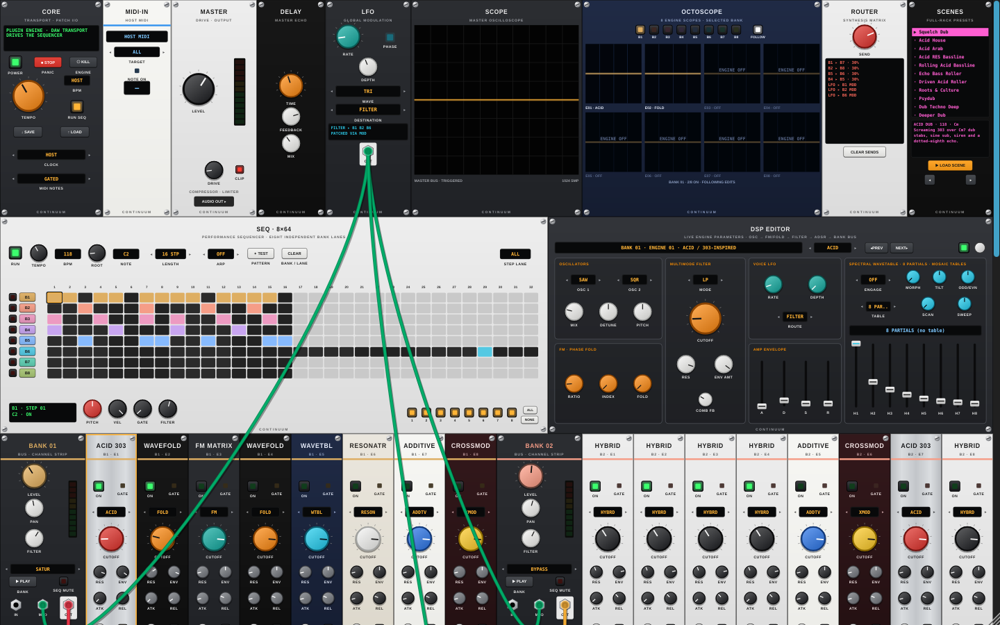

# Continuum Rack · DAW plugin · 0.2.0

The [Continuum Rack web synth](https://stefanopollina.github.io/Hybrid/) (repo `stefanoPollina/Hybrid`) rebuilt as a C++/JUCE instrument plugin for Ableton Live, FL Studio and other VST3 hosts. It has 8 banks × 8 engines, a 64-step sequencer per bank that follows the host's transport, bank send cables, a global LFO, a master echo and a compressor, and all 48 factory scenes.

**Status: source build.** Start with [START_HERE.md](START_HERE.md). This repo holds source code, not a compiled Windows plugin. The engine and plugin have been compiled and tested on Linux. A Windows build and real-DAW checks are still to do (see [docs/VALIDATION.md](docs/VALIDATION.md)).

## Two ways to see the rack

The plugin window shows the rack one of two ways. To switch, use the orange button in the bottom-right corner; the project remembers which one you used.

| View | What it is |
|---|---|
| **WEB RACK** | The Continuum Rack page itself (`Hybrid/index.html`) running in the plugin's WebView: Edge WebView2 on Windows, WKWebView on macOS. Every module works as it does in the browser, including the DSP editor, cables, SCENES, ENGINE ATLAS, FACTORY and MUTATOR. A small bridge script replaces the page's Web Audio engine. Every edit goes to the plugin's C++ engine, which makes the sound in the DAW. Scopes, meters, engine LEDs and the SEQ playhead are fed back from the plugin, and host automation moves the page's knobs. |
| **NATIVE RACK** | The same rack redrawn in JUCE, with no WebView: the same 1740 × 2660 layout, module skins, knob colours and patch cables. It has CORE, MIDI IN, MASTER, DELAY, LFO, SCOPE, OCTOSCOPE, ROUTER, SCENES, SEQ 8×64, DSP EDITOR, the 8 bank strips, all 64 engine modules, KEYS and ENGINE ATLAS. FACTORY and MUTATOR are only in the web view. Ctrl/Cmd + wheel zooms, and the rack opens fitted to the window width. |



## What carries over from the web app

| Web app | Plugin |
|---|---|
| 8 engine types: Acid 303, Hybrid, FM Matrix, Wavefold, Wavetable, Resonator, Additive, Crossmod | Same voice graph, ported node for node from `voice()` |
| 131 Mosaic wavetables (17 frames each), scan and sweep hops, 8-partial waves | Same coefficients, extracted from the page; band-limited per octave |
| Bank strip: filter, insert (BYPASS / SATUR / DARK / HPF / TREM), level, pan | Same chain and curves; level, pan and filter are host parameters |
| Cables: bank OUT → later bank IN sends (max 12), LFO → bank MOD | Same routing rules, including the web app's normalise() |
| SEQ 8 × 64 with arp (up/down/up-down/random), step pitch, velocity, gate up to 3200 %, step filter | Same; clocked by the host's song position |
| CORE save/load (`continuum-synth-p01`) | The plugin's CORE **↓ SAVE / ↑ LOAD** (in both views) read and write the same files |
| 48 scenes | The plugin's preset (program) list, and the SCENES module |
| Keyboard / Web MIDI | MIDI from the host track, gated or one-shot |

Patches move both ways. Save a rack in the browser (CORE ↓ SAVE), then use CORE ↑ LOAD in the plugin, and the other way round.

## Controls in the plugin

| Section | Controls (all host-automatable) |
|---|---|
| Clock | Sequencer Clock: *Host transport* (default), *Internal* or *Off* · Run (internal clock) · Internal Tempo · Root Note |
| Master | Level · Drive |
| Echo | Mix · Time · Feedback |
| LFO | Rate · Depth · Destination (filter/amp/pan) · Wave |
| Router | Send Level (0–40 %) |
| MIDI | Notes: *Gated* (held until note-off, sustain pedal works) or *One-shot (web)*, which plays 0.42 s notes like the browser · Target: all banks or one bank |
| Each bank | Level · Pan · Filter · Seq Mute |
| Window | Which view is open (web or native) is saved with the project |
| Output | Clip at 0 dBFS (on by default, as a browser does at the sound card) |

Everything else in the rack (engine types and voice parameters, steps, arp, engine targets, inserts, cables) is edited in either view, and it is saved with the project.

In both views, **RUN SEQ** starts the internal clock when the DAW is stopped. Pressing play in the DAW hands the clock to the host's transport.

### Clock behaviour

- **Host transport:** steps fall on the host's 16th-note grid from bar 1, so a pattern always lines up with the arrangement. Loops and jumps follow the song position, and pre-roll plays nothing. If the host sends no position (some standalone setups), the internal clock and **Run** take over.
- **Internal:** a free-running clock at Internal Tempo, started and stopped with **Run**.
- MIDI notes play every enabled engine, like the web keyboard, or only the bank chosen as Target. They work with any clock setting, so you can turn the clock **Off** and play the rack as a 64-layer instrument.

## Differences from the browser

The DSP is a port, not a recording of Chrome's output, and a few things differ:

- Web Audio oversamples its wave shapers 2×; this build doesn't, so heavy fold or drive aliases a little more.
- The master compressor uses Chromium's static curve, knee solver, make-up gain and 6 ms look-ahead. The look-ahead is reported to the host as 288 samples of latency at 48 kHz. Chromium's adaptive release is simplified to a fixed 120 ms.
- The comb filter keeps Web Audio's 128-sample minimum delay inside a feedback loop, so it sounds as it does in the browser.
- Voices start on the exact sample; the browser schedules about 8 ms ahead. Filter sweeps and LFOs update every 16 samples.
- The voice pool holds 256 voices. When it is full, the voice nearest its end is reused. The browser has no limit.
- When a short note's release starts, the browser jumps the level straight to the sustain value. The plugin makes the same jump over 1 ms to avoid a click.

## Repository layout

| Path | Purpose |
|---|---|
| `Source/RackModel.*` | Patch data model, web-app defaults and `normalise()` rules |
| `Source/Wavetables.*` | Band-limited tables: Web Audio basic shapes, Mosaic frames, 8-partial waves |
| `Source/RackEngine.*` | The audio engine (no JUCE): voices, bank strips, sends, LFO, echo, compressor, sequencer |
| `Source/RackPatch.*` | JSON ↔ rack state, `continuum-synth-p01` files, factory scenes |
| `Source/PluginProcessor.*` | Parameters, host transport, MIDI, programs, state, patch hand-over to the audio thread |
| `Source/PluginEditor.*` | The plugin window and its WEB RACK / NATIVE RACK switch |
| `Source/WebRackView.*`, `Source/WebBridge.*` | The page in a WebView, and the message bridge to the processor |
| `Source/NativeRack.*` | The native redraw of the rack |
| `Resources/web/` | The page (compressed) and `plugin-bridge.js`, injected before `</body>` |
| `Resources/` | Scenes and wavetables extracted from the web app; see `resource-metadata.json` |
| `scripts/extract-rack-data.cjs` | Regenerates `Resources/` from `Hybrid/index.html` |
| `Tests/` | DSP tests, processor tests, a VST3 host-load check, the page bridge test (`Tests/web/bridge_test.py`, headless Chrome), the web app's example patch |

## Building

The build uses JUCE 8.0.12, pinned to the same commit as the Mosaic Matrix FX build, and CMake 3.24+.

- **Windows:** double-click `Build-Windows.cmd`. The script also downloads the WebView2 SDK package from nuget.org; pass `-NoWebUI` to build without the web view. See [START_HERE.md](START_HERE.md).
- **macOS:** `cmake -S . -B build -G Xcode && cmake --build build --config Release` builds VST3, AU and the standalone app.
- **Linux:** `cmake -S . -B build -DCMAKE_BUILD_TYPE=Release && cmake --build build` needs the usual JUCE packages (X11, Xrandr, Xinerama, Xcursor, freetype, ALSA), plus WebKitGTK 4.1 for the web view. Add `-DRACK_WEB_UI=OFF` to leave out the web view.
- **DSP only, no JUCE:** `scripts/test-core.sh`.

To refresh the factory data after the web app changes:

```sh
node scripts/extract-rack-data.cjs ../Hybrid/index.html
```
